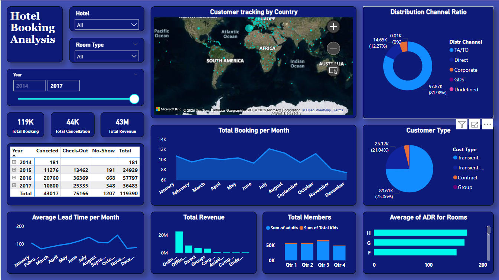

1.  Hotel Booking Analysis: A Global Insight Dashboard

  A dynamic and interactive Power BI dashboard to visualize, analyze, and monitor hotel booking trends across multiple years, countries, and customer types. Designed to empower stakeholders with insights into customer behavior, revenue patterns, and booking channels.
  

2.  Description
   
   The Hotel Booking Analysis Dashboard provides a comprehensive view of booking patterns, cancellations, revenue, and customer segmentation from 2014 to 2017. This tool is aimed at hotel managers, analysts, and marketers to better understand key drivers of booking behavior and optimize operational strategies.
   

3.  Tech Stack

   The dashboard was built using the following tools and technologies:

    📊 Power BI Desktop – For data visualization and dashboard development.

    🔄 Power Query – For ETL (Extract, Transform, Load) processes and shaping raw data.

    📐 DAX (Data Analysis Expressions) – For defining custom KPIs, filters, and interactive visuals.

    🔗 Data Modeling – Relationships established among year-wise metrics, customer types, and channels.

    📁 File Format – .pbit (template) and .PNG for preview and sharing.
    

4.  Data Source
   
  Origin: Simulated hotel booking dataset spanning from 2014–2017.

  Structure:

    •  Yearly breakdown of bookings, cancellations, no-shows, check-outs.

    •  Customer types and distribution channels.

    •  Country-wise customer presence and monthly trends.
    

5.  Features & Highlights

  • Business Problem

  Hotel chains struggle to monitor large volumes of booking data and identify critical patterns across time, location, and customer behavior, which impacts   operational efficiency and revenue strategy.

  • Goal of the Dashboard

  To provide hotel executives with an interactive reporting tool that:

    •  Monitors cancellations and check-outs.

    •  Analyzes lead time and booking patterns.

    •  Tracks revenue by distribution channel.

    •  Segments customers and visualizes global reach.

  • Walkthrough of Key Visuals

  •  Key Metrics (Top Center)

    •  Total Booking: 119K

    •  Total Cancellations: 44K

    •  Total Revenue: 43M

  •  Year-wise Summary Table

    •  Visual breakdown of cancellations, check-outs, and no-shows from 2014 to 2017.

  •  Customer Map (Top Center)

    •  Geolocation of customers worldwide with bubble size indicating volume.

  •  Distribution Channel Ratio (Donut Chart)

     •  82% bookings via TA/TO, followed by Direct and Corporate channels.

  •  Customer Type Segmentation

    •  Majority are Transient customers, followed by Transient-Party and Contract.

  •  Monthly Booking Trend (Area Chart)

    •  Seasonal fluctuations shown across all months.

  •  Average Lead Time (Line Chart)

    •  Shows planning behavior and when customers tend to book in advance.

  •  Revenue Distribution (Bar Chart)

    •  Online TA is the highest revenue generator.

  •  Members (Bar Chart)

    •  Distribution of adults and kids across quarters.

  •  ADR (Average Daily Rate)

    •  Comparison of ADRs across different room types (H, G, F).

5.  Business Impact & Insights

    •  Operational Efficiency: Helps hotels reduce cancellations and no-shows with lead time planning.

    •  Revenue Forecasting: Identifies top-performing channels for targeted marketing.

    •  Global Strategy: Country-wise mapping enables international outreach planning.

    •  Customer Targeting: Segmentation helps tailor services for transient vs contract-based guests.

6.  Screenshots

    An overview of booking trends, customer segmentation, revenue channels, and seasonal behaviors from 2014–2017.
    
     
